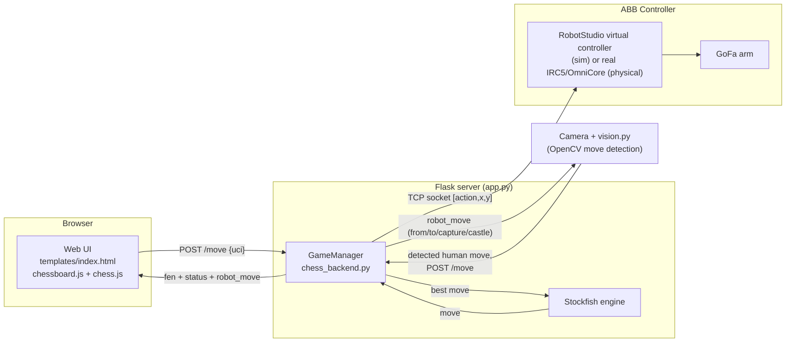
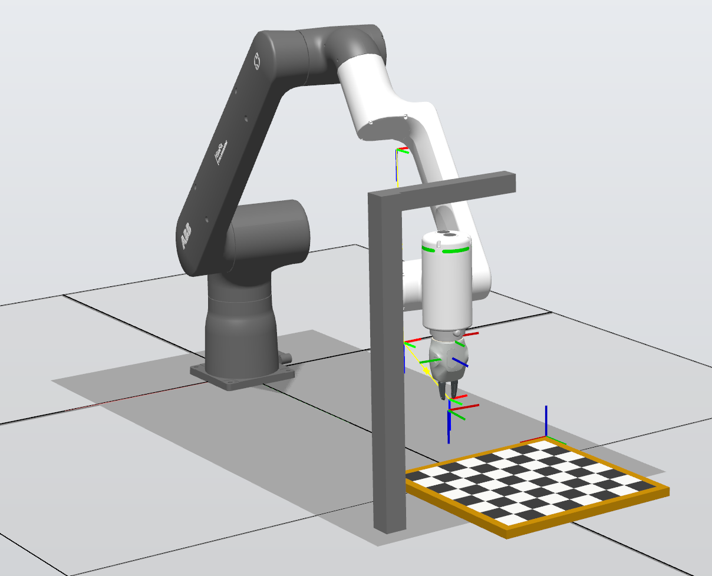
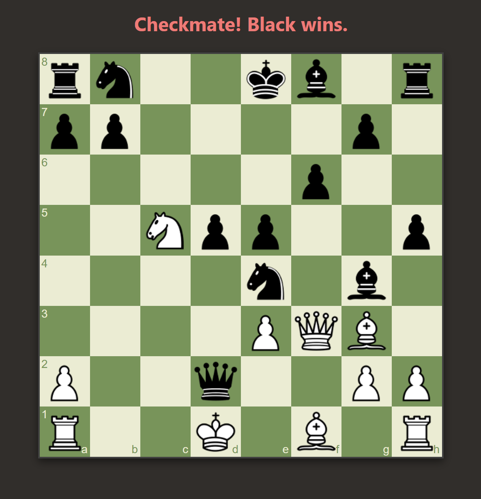
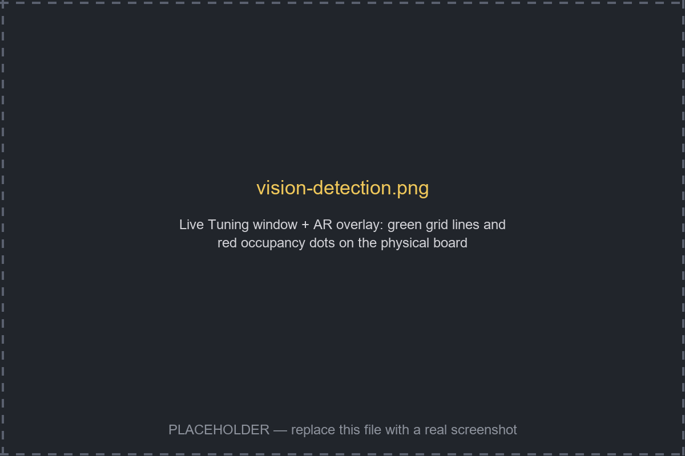

# ABB GoFa Chess HRI

A human-robot chess system: you play chess against [Stockfish](https://stockfishchess.org/) through a web
board, and an ABB GoFa cobot physically executes the engine's moves on a real chessboard — either in
**RobotStudio simulation** or on the **real robot**. A computer-vision script watches the physical board so
you can also make your own moves by hand (no clicking required) and have the app pick them up automatically.

## How it fits together



Two independent ways to make the human move exist side by side:

1. **Click-to-move in the browser** — the web UI is fully playable on its own; the robot still executes
   Stockfish's replies, but nothing physical is required from the human.
2. **Move a real piece on the physical board** — `vision.py` watches the board through a webcam, detects
   which square emptied and which square filled, and POSTs that move to the same `/move` endpoint. This is
   the mode used for actual human-vs-robot play.

Either way, once a move lands on the backend the flow is the same: validate → ask Stockfish for the reply →
drive the robot → return the new state.

## Code structure

| File | Role |
|---|---|
| [`app.py`](app.py) | Flask web server. Three routes: `/` serves the board UI, `/move` accepts a human move (UCI string like `e2e4`), validates it, gets Stockfish's reply, drives the robot, and returns the new FEN/status; `/state` lets clients poll the current board state. |
| [`chess_backend.py`](chess_backend.py) | The core game logic, in two classes: **`GameManager`** owns the `python-chess` board and the Stockfish engine process, validates human moves, and asks Stockfish for the robot's move. **`ChessRobot`** owns the TCP socket to the ABB controller, converts chess squares (`"e4"`) to millimeter coordinates on the physical board, and sequences pick/place actions — including special handling for captures (piece goes to a "graveyard" spot off-board), en passant, and castling (king move + rook move as two separate pick/places). |
| [`vision.py`](vision.py) | Standalone OpenCV script. Finds the board in the camera feed, rectifies it to a top-down view, detects which squares are occupied, and diffs that against the last known state to infer the human's move (departure square → arrival square). Also draws a live AR grid overlay and red dots on occupied squares for visual debugging. On spacebar it computes and submits the detected move; it trusts the `robot_move` the backend echoes back (rather than re-photographing after the robot moves) to update its own memory, since a single post-move frame can be stale while the arm is still in view. |
| [`templates/index.html`](templates/index.html) | The web chess board (chessboard.js + chess.js for client-side legality/rendering), with drag-and-drop moves and a 1-second poll of `/state` so the browser stays in sync if a move was made physically on the real board instead of by clicking. |
| [`static/`](static/) | Vendored front-end libraries: `chess.js` (move legality/SAN), `chessboard-1.0.0.min.js`/`.css` (the visual board widget), `jquery`, and the Wikipedia chess piece image set under `static/img/chesspieces/wikipedia/`. |
| [`tests/`](tests/) | Standalone dev/calibration scripts (gitignored — local scratch space, not part of the shipped app): `stock.py`/`test.py` are earlier CLI-only prototypes of the robot+Stockfish loop, `chess_calib.py`/`blob.py`/`vision_test.py` are vision-calibration experiments. |
| [`ChessMotion.mod`](ChessMotion.mod) | The **RAPID module** that runs on the ABB controller (real or virtual) — the other end of the TCP socket `ChessRobot` talks to. Runs the socket server, parses `[action, x, y]` commands, and drives the actual pick/place motion. |
| [`gofa_chess.rspag`](gofa_chess.rspag) | A **RobotStudio Pack & Go** archive — the complete station, controller system, and libraries needed to reproduce the exact simulation environment shown in this project. |

### The robot protocol

`ChessRobot` (in [`chess_backend.py`](chess_backend.py)) talks to the ABB controller over a plain TCP socket
(default `127.0.0.1:5000`, matching `ChessMotion.mod`'s `SocketBind` for RobotStudio simulation, where
RobotStudio and Python run on the same PC). Each command is a tiny text-encoded action:

```
[1, 123.5, 45.2]   # action 1 = "pick up" at this X/Y (mm)
[2, 210.0, 45.2]   # action 2 = "place down" at this X/Y (mm)
```

Coordinates are computed by `square_to_coords()` from a single `SQUARE_SIZE_MM` constant (currently
`42.1`mm) and an assumed origin at square `h8`.

The other end of that socket is [`ChessMotion.mod`](ChessMotion.mod), the RAPID module actually running on
the controller:

- **`tool`/`wobjdata`/home targets** — `Servo` (the gripper tool), `chess_workobj` (the board's work
  object/frame), and three taught home poses (`pHome`, `tHome`, `tHomeZOffset`) used to park the arm clear of
  the camera at startup and between moves.
- **`PROC main()`** — pulses the gripper open, moves to the home poses, then opens a `socketdev` server on
  port `5000` and loops forever accepting one Python connection at a time.
- **`PROC HandleConnection()`** — the receive loop: blocks on `SocketReceive` (`\Time:=WAIT_MAX`, so it
  waits indefinitely for the next move), parses the `[action, x, y]` string with `StrToVal`, calls
  `ExecuteMove`, and replies `"DONE"` (or `"ERROR"` on a bad parse) — this is the exact string
  `send_action()` in `chess_backend.py` waits for. On disconnect it retracts safely back through the home
  poses.
- **`PROC ExecuteMove(action, x, y)`** — the actual pick/place: hover 100mm above the target, move straight
  down (`z_offset := 25`), pulse `DO16_GripperClose`/`DO16_GripperOpen` depending on whether `action` is `1`
  (pick) or `2` (place), then retract. After a **place**, it also returns to `tHomeZOffset` so the arm is
  clear of the board/camera before the next command arrives.
- **`PROC CalibTest()`** — a manual dry run (no gripper actuation) that jogs to the two far corners and the
  center of the board (`(21,21)`, `(315,315)`, `(168,168)`) — run this once after teaching `chess_workobj`
  to sanity-check your coordinate frame before playing a real game.

> ⚠️ **The address in `ChessMotion.mod`'s `SocketBind` and the `host=` default in `chess_backend.py` must
> always match** — they're the two ends of the same socket. The repo defaults to `127.0.0.1` on both sides
> for **RobotStudio simulation** (Python and the virtual controller on the same PC, so loopback works). If
> you deploy to a **real** controller, change **both**: `SocketBind` needs to bind an address Python can
> actually reach over the network (e.g. the controller's default service-port IP `192.168.125.1`, or `0.0.0.0`
> to listen on all interfaces), and `host=` in `chess_backend.py` needs to point at that same address — see
> [Running with the real robot](#running-with-the-real-robot) below.

## Setup

```bash
pip install flask python-chess opencv-python numpy requests
```

You also need:
- A **Stockfish** binary — update `ENGINE_PATH` in [`app.py`](app.py) to point at your `stockfish.exe`.
- **RobotStudio** (for simulation, see below) or access to the real GoFa's controller, running
  [`ChessMotion.mod`](ChessMotion.mod) — the RAPID socket server that accepts `[action, x, y]` messages and
  replies `DONE`.
- A **webcam** positioned above the board, if you want physical/vision-based move input (`CAMERA_INDEX` in
  [`vision.py`](vision.py)).

## Loading the RobotStudio project

[`gofa_chess.rspag`](gofa_chess.rspag) is a **Pack & Go** archive containing the full station — GoFa model,
controller system, `ChessMotion.mod` already loaded, and all referenced libraries — so you don't need to
rebuild the environment from scratch:

1. In RobotStudio, go to **File → Share → Unpack & Work** (or **Pack & Go → Restore**, depending on your
   RobotStudio version).
2. Point it at `gofa_chess.rspag` and choose a working folder to unpack into.
3. RobotStudio restores the station and its controller system; open the restored station and start the
   **virtual controller** from there.

## Running with RobotStudio (simulation)

1. With the unpacked station's **virtual controller** running (see above), confirm `ChessMotion.mod` is the
   active module and `PROC main()` has been started — the Teach Pendant / RAPID output should show
   `Waiting for Python on port 5000...`, meaning the socket server is up on `127.0.0.1:5000` (matching the
   default `host`/`port` in `ChessRobot`, since Python and the virtual controller run on the same PC).

   

2. Start the Flask server:
   ```bash
   python app.py
   ```
   You should see `Connected to GoFa!` printed if the socket connected — if the controller isn't reachable
   yet, `ChessRobot` just prints a warning and the game still runs (moves will "simulate" in the console,
   i.e. print instead of sending).

3. Open **http://localhost:5050** in a browser and play — drag a piece to move as White. The server asks
   Stockfish for Black's reply and sends the corresponding pick/place commands to RobotStudio.

   

4. Watch RobotStudio's 3D view — the simulated GoFa should pick up and place the piece for Stockfish's move.

5. *(Optional)* If you also want to feed in human moves by "moving" pieces on a physical calibration board
   instead of clicking, run `vision.py` alongside `app.py` (see the Vision section below) — otherwise just
   play by dragging pieces in the browser.

## Running with the real robot

1. Load [`ChessMotion.mod`](ChessMotion.mod) onto the real IRC5/OmniCore controller (via RobotStudio's
   online/connect-to-controller mode, or by importing it directly on the Teach Pendant). Change the
   `SocketBind` address in `PROC main()` from `"127.0.0.1"` to an address reachable over your real network —
   e.g. `192.168.125.1` (the controller's default service-port IP) if connecting directly, `"0.0.0.0"` to
   listen on all interfaces, or the controller's LAN IP. The loopback address only works when Python and the
   controller are the same machine, which is only true for the RobotStudio virtual controller.

2. Point `ChessRobot` at that same real controller IP instead of the simulation default — either edit the
   `host` default in [`chess_backend.py`](chess_backend.py) or pass `host=` when constructing `GameManager`/
   `ChessRobot`. It must match whatever you set `SocketBind` to in step 1.

3. **Physically calibrate the board**: measure your real board's square size in mm and update
   `SQUARE_SIZE_MM` in [`app.py`](app.py), and make sure the robot's taught origin/frame matches what
   `square_to_coords()` assumes (origin at the `h8` corner, X increasing toward `a`, Y increasing toward
   rank 1). Also teach a safe "graveyard" drop zone for captured pieces — currently hardcoded to
   `(-100.0, 200.0)` mm in both `ChessRobot.execute_chess_move()` calls. Run `PROC CalibTest()` in
   `ChessMotion.mod` first to sanity-check the frame before playing a real game.

4. Position the camera above the real board and run:
   ```bash
   python vision.py
   ```
   Use the **Live Tuning** trackbar window to dial in board detection for your lighting (see next section).

5. Run `python app.py`, open the UI to spectate/verify state, and play by physically moving pieces on the
   board — the workflow is: make your move → press **Space** in the vision window → the app validates it,
   drives the robot, and the UI updates.

   A human move followed by the robot's reply, played out on the real board:

   <video src="https://github.com/abdulmaajidaga/ABB_Gofa_Chess_HRI/raw/main/docs/videos/real-robot-game.mp4" controls width="600"></video>

   (If the player doesn't render for you, [open the video file directly](https://github.com/abdulmaajidaga/ABB_Gofa_Chess_HRI/blob/main/docs/videos/real-robot-game.mp4).)

   ⚠️ **Safety**: keep hands clear of the workspace while the arm is moving, and verify the taught graveyard
   and board-corner positions in a slow/manual jog before running full-speed automatic play.

## Vision: how move detection works, and how to tune it

`vision.py` opens a **"Live Tuning"** window with trackbars used to isolate the board and pieces from the
camera feed:

| Trackbar | Purpose |
|---|---|
| Saturation | Threshold used to find the board's outer boundary (coarse pass) |
| Min/Max Sq Size | Contour-area range for a valid inner board square, used to find the playing-surface corners precisely (fine pass) |
| Lighting Filter | Adaptive-threshold block size — raise this if lighting is uneven across the board |
| Piece Sens (1–10) | Edge-density threshold for deciding a square is occupied — lower this if pieces aren't being detected, raise it if empty squares are false-flagged |
| Canny Min/Max | Edge-detector thresholds feeding the piece-occupancy check |

Also tune `OFFSET_TOP/BOTTOM/LEFT/RIGHT` at the top of the file to crop the raw camera frame down to just
the board + a small margin.



**Controls while `vision.py` is running:**
- **Space** — capture the current frame, diff it against the last known board state, and submit the
  detected move (or castling, if two squares changed) to the backend.
- **`r`** — resync: reset the vision script's memory of the board to exactly what the camera currently sees
  (use this if a move was misread and the internal state has drifted from reality).
- **Esc** — quit.

The script deliberately does **not** re-photograph the board after the robot moves — instead it applies the
exact move the backend reports it played (`robot_move` in the `/move` response, built by
`GameManager._describe_move()`) directly to its own occupancy memory. This avoids corrupting state from a
stale frame while the arm is still mid-motion or blocking the camera.

## Notes / known limitations

- `ENGINE_PATH` and the RobotStudio host/port are hardcoded — worth moving to environment variables or a
  config file if this grows further.
- `vision.py`'s move inference assumes exactly one departure + one arrival per move (or the specific
  2-departure/2-arrival castling pattern); a misdetected frame can require a manual `r` resync.
- Pawn promotion always defaults to Queen on the frontend (`promotion: 'q'` in `templates/index.html`).
